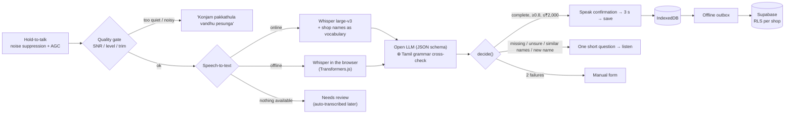

# கடன் கணக்கு · Kadan Kanakku

**A voice-first credit ledger for kirana shops in Tamil Nadu — speak Tamil, English or Tanglish, and it keeps the book.**
Fully open source: MIT-licensed code, open-weight AI models, self-hostable end to end, and it still works with **no internet** thanks to Whisper running on the phone.

> *"Murugan anna, 240 rupees, arisi and oil, kadan"*
> 🔊 *"Murugan anna, 240 roobaai kadan. Mottham baaki 1,140."* — saved 3 seconds later unless you say *"venaam"*.

---

## The problem

A provision-shop owner sells on credit to dozens of regulars a day, at a noisy counter, hands full, eyes on the customer. Entries get skipped, amounts get disputed, month-end turns into arguments. Ledger apps exist, but they need typing — in English — which these owners have no time (and often no comfort) for.

## What it does

Hold the big mic button and talk the way you already talk:

| You say | It says back (in your language) |
|---|---|
| Murugan anna, 240 rupees, arisi and oil, kadan | Murugan anna, 240 roobaai kadan. Mottham baaki 1,140. |
| Murugan anna 100 kuduthaar | Murugan anna 100 kuduthaar. Innum baaki 1,040. |
| Murugan evlo baaki? | Murugan anna-kku baaki 1,040. |
| How much does Selvi owe? | Selvi akka owes 2,150. |
| Ravi kadan *(no amount)* | Evlo roobaai? Thirumba sollunga. → *"nootri irubathu"* → saved ₹120 |
| Murugasan 300 kadan *(sounds like two people)* | Murugesan-va, Murugan anna-a? → the answer is **remembered as an alias** |
| Ganesh 300 kadan *(unknown)* | Ganesh pudhu customer-a? Save pannattuma? |
| Ravi 2500 kadan *(> ₹2,000)* | Ravi, 2,500-nu sonneenga, sariya? |
| Last-a pottadha cancel pannu | Seri, cancel pannitten. |
| *(too far / too noisy)* | Konjam pakkathula vandhu pesunga. *(never guesses)* |
| *(two failed tries)* | Puriyala. Screen-la type pannunga. → manual form, clip kept in **Needs review** |

Every entry keeps its **transcript and voice clip** — tap ▶ to replay it when a customer disputes an amount. Customers get a polite **WhatsApp reminder** in Tamil or English.

## 100% open-source AI stack

| Layer | What runs | License | Where |
|---|---|---|---|
| Speech → text (server) | **Whisper large-v3** (OpenAI open weights) via [speaches](https://github.com/speaches-ai/speaches)/faster-whisper, or Groq | MIT | your server / Groq |
| Speech → text (on the phone) | **Whisper tiny/base/small** in a Web Worker via [Transformers.js](https://github.com/huggingface/transformers.js) + ONNX Runtime Web | MIT / Apache-2.0 | the phone, offline |
| Understanding | **Qwen 2.5 / Llama 3.x / gpt-oss** via any OpenAI-compatible server (Ollama, vLLM, llama.cpp, Groq) with JSON-schema output, validated by zod | Apache-2.0 / Llama | your server / Groq |
| Understanding (on the phone) | Hand-built **Tamil + English grammar**: transliteration, sound-skeleton name matching, Tamil/English/mixed number parser | MIT (this repo) | the phone, offline |
| Text → speech | Phone voice (`ta-IN`), or **AI4Bharat Indic Parler-TTS** server | Apache-2.0 | phone / your server |
| Data, auth, storage | **Supabase** (Postgres + RLS, phone OTP, Storage) | Apache-2.0 | Supabase cloud or self-hosted |
| App | React 19 + Tailwind 4 PWA, IndexedDB offline queue | MIT | the phone |

No proprietary AI API is required. API keys and model endpoints live only in the edge functions.

## How it works



**Hybrid understanding.** The LLM handles messy phrasing; the on-device grammar is deterministic about numbers and names. When they disagree on an amount the user actually said in digits, confidence drops below 0.8 and the app **confirms aloud instead of saving silently**. If the LLM is unreachable, the grammar alone runs the whole flow — so voice entry keeps working offline.

**Names by sound, not spelling.** Every name is reduced to a *sound skeleton* (Tamil script transliterated, aspiration/voicing/vowel length/doubling folded, vocative and case endings like *-kku, -oda* stripped): `Murugan`, `Muruga`, `முருகன்`, `Muruganukku` all match; `Laxmi` = `Lakshmi`; honorifics (*anna, akka, sir*) are ignored. Every correction becomes a **shop-specific alias**, so recognition improves with use.

**Numbers in any language.** `240`, `₹1,500`, `2k`, `two-forty`, `fifteen hundred`, `irunooru naarpadhu`, `இருநூற்று நாற்பது`, `aayirathu ainooru`, `irubathiyanju`, `rendu thousand` … and `two kilo arisi, 120` correctly reads ₹120 (quantities aren't prices).

**Never drop an entry.** Unclear or noisy clips are stored as *Needs review* with their audio; if a retry succeeds they're resolved automatically. Clips recorded with no engine available are transcribed in the background when one comes back, with a one-tap suggestion.

## Quick start (demo mode — 1 minute)

```powershell
npm install
npm run dev
```

Open http://localhost:5173. With no Supabase keys the app runs in **demo mode**: a seeded shop with 6 customers and 3 weeks of entries, stored on the device. Speech uses on-device Whisper (Settings → *On-device AI* → download *Whisper base*, ~73 MB, once) or the browser's recogniser; understanding uses the on-device grammar. You can also tap *Type instead* to try commands without a mic.

## Full setup

### 1. Supabase (database, phone OTP, audio storage)

```powershell
npx supabase start
```

```powershell
npx supabase db reset
```

This applies [supabase/migrations](supabase/migrations/20261122000000_init.sql): tables, computed `customer_balances` view, row-level security (each user sees only their shop), the private `entry-audio` bucket, and `create_shop()`. Locally, phone `+91 99999 99999` always accepts OTP `123456` ([config.toml](supabase/config.toml)); for real SMS configure an SMS provider in Supabase Auth.

Create `.env.local` from [.env.example](.env.example) with `VITE_SUPABASE_URL` and `VITE_SUPABASE_ANON_KEY`. On first sign-in the app offers to create your shop and load the demo ledger.

### 2. Open AI models — pick one

**A. Self-hosted (fully open, nothing leaves your machines)**

```powershell
docker compose -f ai-server/docker-compose.yml up -d
```

Starts Whisper (`:8000/v1`) and Ollama with `qwen2.5:7b-instruct` (`:11434/v1`). Add `--profile tts` for the Indic Parler-TTS voice (GPU recommended; the model may require accepting its terms on Hugging Face and an `HF_TOKEN`).

**B. Hosted open weights on Groq (fastest to try)** — `whisper-large-v3` + `llama-3.3-70b-versatile`, same API.

Then configure and deploy the functions:

```powershell
Copy-Item supabase/functions/.env.example supabase/functions/.env
```

```powershell
npx supabase functions serve --env-file supabase/functions/.env
```

For hosted Supabase: `npx supabase secrets set --env-file supabase/functions/.env` and `npx supabase functions deploy transcribe understand speak`. If a variable is missing, that function answers `503 not_configured` and the app quietly switches to its on-device fallback.

### 3. On a real Android phone

The microphone needs HTTPS. Either deploy `dist/` (`npm run build`) to any static host (Netlify, Vercel, Cloudflare Pages, Supabase Storage), or tunnel the dev server (`npx cloudflared tunnel --url http://localhost:5173`). Open it in Chrome → *Add to Home screen*. For Tamil spoken replies install the Tamil voice in Android *Settings → Text-to-speech → Google → Install voice data → தமிழ்*; without it the app reads the Tanglish line in an Indian-English voice.

## Project layout

```
src/
  i18n/            ta.js, en.js — labels, spoken replies, WhatsApp text, parser vocabulary (add hi.js, te.js here)
  lib/             translit, names (sound matching), numbers, localParser, ledger maths, IndexedDB store, sync, auth, seed
  voice/           recorder (worklet, VAD/trim, quality gate), whisper.worker + localWhisper (on-device),
                   stt / nlu / tts routers, decide (conversation brain), useVoiceFlow, reprocess
  components/, screens/   Home (mic), Customers, Customer detail, Settings, Login
supabase/
  migrations/      schema + RLS + storage policies
  functions/       transcribe (Whisper), understand (open LLM), speak (Indic Parler-TTS)
ai-server/         docker-compose: speaches + Ollama (+ TTS)
```

## Tests

```powershell
npm test
```

86 unit tests cover Tamil/English/mixed number parsing, transliteration and sound matching, every spoken reply in the spec (asserted word for word), the clarification / alias / new-customer / large-amount / undo / two-failure flows, the LLM ⊕ grammar merge, and the audio quality gate.

## Adding a language

Copy [src/i18n/ta.js](src/i18n/ta.js) to e.g. `te.js`, translate `labels`, `replies`, `whatsapp`, fill `lexicon` and `numbers` (spellings in Latin and native script), and register it in [src/i18n/index.js](src/i18n/index.js). Labels, replies and the on-device parser pick it up automatically.

## Status against the brief

| Done-when item | Status |
|---|---|
| Credit & payment entries saved and confirmed aloud in Tamil or English | ✅ verified in the browser (typed path) and unit tests; mic path needs a phone check |
| Balance queries correct | ✅ computed live from entries, never stored |
| New and similar names trigger questions; corrections become aliases | ✅ verified in the browser |
| Mixed-language numbers parse | ✅ 40+ number tests incl. Tamil script |
| Noisy audio is re-asked, never saved wrong | ✅ quality gate verified on real speech with added noise |
| Voice undo | ✅ verified |
| Offline sync | ✅ outbox + pull implemented; needs a live Supabase project to exercise |
| WhatsApp reminders | ✅ Tamil and English `wa.me` messages |
| On-device Whisper | ✅ verified in the browser: 11 s clip transcribed in 2.1 s |

Honest limits: Whisper tiny/base are rough on Tamil — they're the offline safety net; server `large-v3` is the main engine. The Indic Parler-TTS server is optional and slower on CPU than the phone's own voice.

## License

[MIT](LICENSE). Model weights keep their own licenses (Whisper: MIT; Qwen 2.5: Apache-2.0; Llama 3.x: Llama Community License; Indic Parler-TTS: Apache-2.0).
