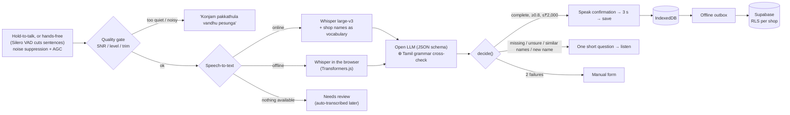

# கடன் கணக்கு · Kadan Kanakku

[](https://github.com/Hemanth05065/kadan-kanakku/actions/workflows/ci.yml)  

**A voice-first credit ledger for kirana shops in Tamil Nadu — speak Tamil, English or Tanglish (Hindi and Telugu too), and it keeps the book.**
Fully open source: MIT-licensed code, open-weight AI models, self-hostable end to end, and it still works with **no internet** thanks to Whisper running on the phone.

> *"Murugan anna, 240 rupees, arisi and oil, kadan"*
> 🔊 *"Murugan anna, 240 roobaai kadan. Mottham baaki 1,140."* — saved 3 seconds later unless you say *"venaam"*.

---

## The problem

A provision-shop owner sells on credit to dozens of regulars a day, at a noisy counter, hands full, eyes on the customer. Entries get skipped, amounts get disputed, month-end turns into arguments. Ledger apps exist, but they need typing — in English — which these owners have no time (and often no comfort) for.

## What it does

Hold the big mic button (or switch on **hands-free** and just talk) the way you already talk:

| You say | It says back (in your language) |
|---|---|
| Murugan anna, 240 rupees, arisi and oil, kadan | Murugan anna, 240 roobaai kadan. Mottham baaki 1,140. |
| Murugan anna 100 kuduthaar | Murugan anna 100 kuduthaar. Innum baaki 1,040. |
| Murugan evlo baaki? | Murugan anna-kku baaki 1,040. |
| How much does Selvi owe? | Selvi akka owes 2,150. |
| Ravi kadan *(no amount)* | Evlo roobaai? Thirumba sollunga. → *"nootri irubathu"* → saved ₹120 |
| Murugasan 300 kadan *(sounds like two people)* | Murugesan-va, Murugan anna-a? → the answer is **remembered as an alias** |
| Ganesh 300 kadan *(unknown)* | Ganesh pudhu customer-a? Save pannattuma? |
| Ravi 2500 kadan *(> ₹2,000)* | Ravi, 2,500-nu sonneenga, sariya? |
| Last-a pottadha cancel pannu | Seri, cancel pannitten. |
| *(too far / too noisy)* | Konjam pakkathula vandhu pesunga. *(never guesses)* |
| *(two failed tries)* | Puriyala. Screen-la type pannunga. → manual form, clip kept in **Needs review** |
| Indru kanakku evlo? | Indru 3,340 kadan, 100 varavu. Mottham baaki 8,400. |
| Murugan anna-ku QR kaattu | Murugan anna, 1,140 roobaai. QR kaattren, scan pannunga. → a UPI QR for exactly 1,140 fills the screen |
| Ravi ka dedh sau udhaar *(Hindi)* | Ravi, 150 rupaye udhaar. Kul baaki … |
| Ravi garu rendu vandala yabhai appu *(Telugu)* | Ravi garu, 250 rupayalu appu. Motham baaki … |

Every entry keeps its **transcript and voice clip** — tap ▶ to replay it when a customer disputes an amount.

**Hands-free, for full hands.** Tap 🎧 once and keep working: the app listens, notices when a sentence starts and ends (the open-source [Silero](https://github.com/snakers4/silero-vad) voice detector, running in the phone), and answers. It is deaf while it speaks, so it never answers itself, and it ignores the shop's chatter: outside a conversation only a clear ledger command counts (a name with an amount, a balance question, today's total). A customer's "illa" or "seri" is never taken as an answer and never undoes an entry; the owner's "venaam" right after the save chime does. A short pause ends a sentence (short / normal / long in Settings). The screen stays on while it listens, and it turns itself off after 10 quiet minutes or when the app is closed.

**A real voice, not a robot.** In *Settings → Shop voice* someone at the shop records the reply phrases, the Tamil number words (with their joining forms: *irunoothi naappadhu* = 240) and each customer's name, about 15 minutes in all, once. Every reply is then stitched from those clips, the way station announcements are, so the app answers in a real person's voice, offline and with no delay. If a word is missing, that reply uses the phone's voice instead; a name that isn't recorded yet is simply left out. The recorded voice can be saved as a file and opened on a staff phone. With no recorded voice, the app picks the most natural phone voice (Google's Tamil voice on Android, Microsoft's natural voices in Edge) and never reads Tamil in a British or American accent.

**Also in the box**

- **Month-end statement** per customer: opening balance, every entry with running balance, closing balance. Save as PDF from the phone's print dialog (renders Tamil/Hindi/Telugu correctly) or send as WhatsApp text.
- **Collect today** on the home screen: who to ask for money, most urgent first, with the reason in plain words ("no payment for 20 days · took ₹200 more on credit this week") and a one-tap WhatsApp reminder each. It weighs how much is owed by how long it has waited, leaves alone anyone who paid this week or was reminded today or yesterday, and skips tiny balances. 🔊 reads it out, and you can ask by voice: *"Indru yaar kitta vasool pannanum?"*. "Selvi akka kitta 500 vasool aachu" records the money collected.
- **UPI payments**: add the shop's UPI ID once (Settings). Every customer page then has a QR for the exact balance to scan at the counter (or say *"Murugan anna-ku QR kaattu"*). Every WhatsApp reminder and statement ends with a pay link: a small page that opens GPay / PhonePe / Paytm / BHIM with the shop's UPI ID and the amount filled in. The page needs no account and stores nothing: everything it shows is in the link. Money goes straight from the customer's bank to the shop's; the app never touches it.
- **30+ days unpaid** list with one-tap WhatsApp reminders in the customer's language; the app remembers who was reminded when.
- **Staff accounts**: the owner shares a 6-digit code, staff sign in with their own phone. Staff can add entries but not hard-delete; every entry records who made it.
- **Today's summary** by voice or button at closing time.
- **Demo autopilot** (Home → ▶ Demo): plays a scripted counter conversation through the real pipeline with captions, so a noisy hall can't break a pitch. See [docs/PITCH.md](docs/PITCH.md).
- **Accuracy lab** (Settings): say test phrases into the real mic and see word error rate and understanding; export the recordings to score other speech engines.

## 100% open-source AI stack

| Layer | What runs | License | Where |
|---|---|---|---|
| Speech → text (server) | **Whisper large-v3** (OpenAI open weights) via [speaches](https://github.com/speaches-ai/speaches)/faster-whisper, or Groq | MIT | your server / Groq |
| Speech → text (on the phone) | **Whisper tiny/base/small** in a Web Worker via [Transformers.js](https://github.com/huggingface/transformers.js) + ONNX Runtime Web | MIT / Apache-2.0 | the phone, offline |
| Speech → text, trained on Tamil (on the phone) | **[Swanada](https://github.com/hemanth/swanada)** (27 MB per language, trained on Indian languages, native script) or a **[Tamil-retrained Whisper medium](https://huggingface.co/santhosh63/whisper-tamil-medium-web)** (776 MB, from vasista22/whisper-tamil-medium) | MIT / Apache-2.0 | the phone, offline |
| Hands-free listening | **Silero VAD** ([onnx-community/silero-vad](https://huggingface.co/onnx-community/silero-vad), 2 MB) in its own worker; a loudness detector if it can't load | MIT | the phone, offline |
| Understanding | **Qwen 2.5 / Llama 3.x / gpt-oss** via any OpenAI-compatible server (Ollama, vLLM, llama.cpp, Groq) with JSON-schema output, validated by zod | Apache-2.0 / Llama | your server / Groq |
| Understanding (on the phone) | Hand-built **Tamil + English grammar**: transliteration, sound-skeleton name matching, Tamil/English/mixed number parser | MIT (this repo) | the phone, offline |
| Speaking back | **The shop voice**: phrases, number words and names recorded by a real person and stitched together; else the phone's voice (`ta-IN`, natural voices first), or the **AI4Bharat Indic Parler-TTS** server | MIT (this repo) / Apache-2.0 | the phone, offline / your server |
| Data, auth, storage | **Supabase** (Postgres + RLS, phone OTP, Storage) | Apache-2.0 | Supabase cloud or self-hosted |
| App | React 19 + Tailwind 4 PWA, IndexedDB offline queue | MIT | the phone |

No proprietary AI API is required. API keys and model endpoints live only in the edge functions.

## How it works



**Hybrid understanding.** The LLM handles messy phrasing; the on-device grammar is deterministic about numbers and names. When they disagree on an amount the user actually said in digits, confidence drops below 0.8 and the app **confirms aloud instead of saving silently**. If the LLM is unreachable, the grammar alone runs the whole flow — so voice entry keeps working offline.

**Whisper hallucination guard.** On noise, Whisper sometimes loops ("thank you thank you…") or invents long sentences. Output that repeats or is far longer than the audio could hold is treated as "didn't hear you", and on-device decoding is capped at 64 tokens (8.5 s → 1.6 s on a noise clip).

**Names by sound, not spelling.** Every name is reduced to a *sound skeleton* (Tamil script transliterated, aspiration/voicing/vowel length/doubling folded, vocative and case endings like *-kku, -oda* stripped): `Murugan`, `Muruga`, `முருகன்`, `Muruganukku` all match; `Laxmi` = `Lakshmi`; honorifics (*anna, akka, sir*) are ignored. Every correction becomes a **shop-specific alias**, so recognition improves with use.

**Numbers in any language.** `240`, `₹1,500`, `2k`, `two-forty`, `fifteen hundred`, `irunooru naarpadhu`, `இருநூற்று நாற்பது`, `aayirathu ainooru`, `irubathiyanju`, `rendu thousand`, Hindi `dedh sau` / `saade teen sau`, Telugu `rendu vandala yabhai` … and `two kilo arisi, 120` correctly reads ₹120 (quantities aren't prices; `2 kg` is never "2 thousand"). The same sound can mean different numbers in different languages (Telugu *edu* = 7, Tamil *ettu* = 8), so the utterance's language is detected first.

**Never drop an entry.** Unclear or noisy clips are stored as *Needs review* with their audio; if a retry succeeds they're resolved automatically. Clips recorded with no engine available are transcribed in the background when one comes back, with a one-tap suggestion.

## Quick start (demo mode — 1 minute)

```powershell
npm install
npm run dev
```

Open http://localhost:5173. With no Supabase keys the app runs in **demo mode**: a seeded shop with 6 customers and 3 weeks of entries, stored on the device. Speech uses on-device Whisper (Settings → *On-device AI* → download *Whisper base*, ~73 MB, once) or the browser's recogniser; understanding uses the on-device grammar. You can also tap *Type instead* to try commands without a mic.

## Full setup

### 1. Supabase (database, phone OTP, audio storage)

```powershell
npx supabase start
```

```powershell
npx supabase db reset
```

This applies [supabase/migrations](supabase/migrations/20261122000000_init.sql): tables, computed `customer_balances` view, row-level security (each user sees only their shop), the private `entry-audio` bucket, and `create_shop()`. Locally, phone `+91 99999 99999` always accepts OTP `123456` ([config.toml](supabase/config.toml)); for real SMS configure an SMS provider in Supabase Auth.

Create `.env.local` from [.env.example](.env.example) with `VITE_SUPABASE_URL` and `VITE_SUPABASE_ANON_KEY`. On first sign-in the app offers to create your shop and load the demo ledger.

### 2. Open AI models — pick one

**A. Self-hosted (fully open, nothing leaves your machines)**

```powershell
docker compose -f ai-server/docker-compose.yml up -d
```

Starts Whisper (`:8000/v1`) and Ollama with `qwen2.5:7b-instruct` (`:11434/v1`). Add `--profile tts` for the Indic Parler-TTS voice (GPU recommended; the model may require accepting its terms on Hugging Face and an `HF_TOKEN`).

**B. Hosted open weights on Groq (fastest to try)** — `whisper-large-v3` + `llama-3.3-70b-versatile`, same API.

Then configure and deploy the functions:

```powershell
Copy-Item supabase/functions/.env.example supabase/functions/.env
```

```powershell
npx supabase functions serve --env-file supabase/functions/.env
```

For hosted Supabase: `npx supabase secrets set --env-file supabase/functions/.env` and `npx supabase functions deploy transcribe understand speak`. If a variable is missing, that function answers `503 not_configured` and the app quietly switches to its on-device fallback.

### 3. On a real Android phone

The microphone needs HTTPS. Either deploy `dist/` (`npm run build`) to any static host (Netlify, Vercel, Cloudflare Pages, Supabase Storage), or tunnel the dev server (`npx cloudflared tunnel --url http://localhost:5173`). Open it in Chrome → *Add to Home screen*. For Tamil spoken replies install the Tamil voice in Android *Settings → Text-to-speech → Google → Install voice data → தமிழ்*; without it the app reads the Tanglish line in an Indian-English voice.

## Project layout

```
src/
  i18n/            ta.js, en.js, hi.js, te.js — labels, spoken replies, WhatsApp text, parser vocabulary
  lib/             translit, names (sound matching), numbers, localParser, ledger maths, collect (who to ask for money), IndexedDB store, sync, auth, seed
  voice/           recorder (worklet, VAD/trim, quality gate), whisper.worker + swanada.worker + localWhisper (on-device),
                   stt / nlu / tts routers, decide (conversation brain), useVoiceFlow, reprocess,
                   voicePack (recording script, Tamil number words, sentence stitching), voiceClips (storage, playback),
                   vad + silero + vad.worker + handsFree (hands-free listening)
  components/, screens/   Home (mic), Customers (+30-day overdue), Customer detail, Statement, Settings, Shop voice, Accuracy lab, Login
supabase/
  migrations/      schema + RLS + storage policies
  functions/       transcribe (Whisper), understand (open LLM), speak (Indic Parler-TTS)
  tests/           migration + row-level security tests on real Postgres (PGlite)
ai-server/         docker-compose: speaches + Ollama (+ TTS)
eval/              cases.json: counter phrases with expected commands
scripts/           eval-nlu.mjs (understanding), eval-stt.mjs (speech engines), make-icons.mjs
docs/              PITCH.md (2-minute demo), architecture.svg
```

## Tests and accuracy

```powershell
npm test
```

250+ tests, no network or Docker needed:

- number parsing in Tamil, English, Hindi and Telugu (Latin and native scripts), transliteration, sound matching
- every spoken reply in the brief, asserted word for word, and the clarification / alias / new-customer / large-amount / undo / two-failure flows
- the audio quality gate and the Whisper hallucination guard
- the shop voice: Tamil number words up to 10 lakh, every reply stitched from clips (with and without recorded names), clip clean-up (trim, level, fades; refusing silence, whispers and distortion) and phone-voice choice (never a British voice for Tamil)
- hands-free: cutting a microphone stream into sentences (pauses inside a sentence, coughs, 15 s cut-off), staying deaf while the app speaks, and which overheard phrases it acts on
- who to collect from: ranking, the reasons shown, who is left alone, and the spoken question in four languages
- UPI: the upi://pay link, UPI ID checks, the pay-page link (Tamil names, tampered links), pay links in reminders, and "show the QR" by voice in four languages
- the offline outbox and sync (IndexedDB faked, Supabase client faked)
- **the real database migration on PostgreSQL 18** (PGlite, in-process): shop isolation under row-level security, computed balances, staff invites, owner-only hard deletes, private audio storage

```powershell
npm run eval:nlu
```

Scores understanding on [eval/cases.json](eval/cases.json): 74 counter phrases across Tamil (Latin and Tamil script, Chennai/Madurai/Coimbatore phrasing), English, Hindi and Telugu. Current result for the on-device grammar: **100% with intent, customer and amount all right, and 0 "silent wrong saves"** (wrong entries confident enough to save without asking — the number that must stay at zero). Add `--llm` with `LLM_BASE_URL`/`LLM_MODEL` set to score your open LLM and the LLM ⊕ grammar merge with the exact server prompt. Honest caveat: these phrases were written by us; real accuracy comes from real voices:

```powershell
npm run eval:stt -- kadan-eval.json --engine local:onnx-community/whisper-base
```

Record phrases in the app's **Accuracy lab**, export, and score any Whisper (server with `--engine server`, or local models; models cache under `~/.cache/kadan-kanakku`). A Tamil-tuned Whisper medium exists for the browser (`santhosh63/whisper-tamil-medium-web`, 740 MB, laptops only) and in CTranslate2 form for servers; this is how you'd decide whether it beats large-v3 for your shops.

CI runs all of the above (eval must stay ≥ 95%), the build, and a Deno type-check of the edge functions.

## Adding a language

Hindi ([hi.js](src/i18n/hi.js)) and Telugu ([te.js](src/i18n/te.js)) were added exactly this way. Copy [src/i18n/ta.js](src/i18n/ta.js) to e.g. `kn.js`, translate `labels`, `replies`, `whatsapp`, fill `lexicon` and `numbers` (spellings in Latin and native script), and register it in [src/i18n/index.js](src/i18n/index.js). Labels, replies and the on-device parser pick it up automatically.

## Status against the brief

| Done-when item | Status |
|---|---|
| Credit & payment entries saved and confirmed aloud in Tamil or English | ✅ verified in the browser (typed path) and unit tests; mic path needs a phone check |
| Balance queries correct | ✅ computed live from entries, never stored |
| New and similar names trigger questions; corrections become aliases | ✅ verified in the browser |
| Mixed-language numbers parse | ✅ 40+ number tests incl. Tamil script |
| Noisy audio is re-asked, never saved wrong | ✅ quality gate verified on real speech with added noise |
| Voice undo | ✅ verified |
| Offline sync | ✅ outbox + pull tested with faked IndexedDB/Supabase; schema + RLS tested on real Postgres (PGlite); still to try against a live Supabase project |
| WhatsApp reminders | ✅ Tamil and English `wa.me` messages |
| On-device Whisper | ✅ verified in the browser: 11 s clip transcribed in 2.1 s |
| Tamil-trained on-device models | Swanada: ✅ downloads (27 MB), loads offline from cache and transcribes in the browser (4.5 s of audio in 0.3 s); Tamil accuracy still to measure on real voices in the Accuracy lab. Tamil Whisper medium: listed, uses the same tested Whisper path, not downloaded here (776 MB) |
| Collect today | ✅ unit-tested; card, reasons, WhatsApp link and the spoken question checked in the browser |
| UPI payments | ✅ unit-tested; in the browser: UPI ID saved, "Murugan anna-ku QR kaattu" opened the QR for ₹900, the customer page, statement and reminders carry the QR / pay link, and the pay link opens the standalone pay page with the right upi:// link; still to scan with a real UPI app |
| Hands-free listening | ✅ unit-tested; in the browser, with recorded speech played into the page as the microphone: Silero loaded, a sentence was heard, transcribed on the device and saved, chatter and a stray "No." were ignored, "No." mid-question and right after the save chime were acted on; still to try with a real mic in a real shop |
| Shop voice (recorded human voice) | ✅ stitching, Tamil numbers, clip clean-up and fallbacks unit-tested; save → stitch → play and file export/import verified in the browser with generated test audio; still to record a real voice on a real phone mic |

See [CONTRIBUTING.md](CONTRIBUTING.md) to help, and [docs/PITCH.md](docs/PITCH.md) for the 2-minute demo.

Honest limits: Whisper tiny/base are rough on Tamil, so the Tamil-trained choices exist; how much better they are on real shop voices is not measured yet. Server `large-v3` is the main engine. The Indic Parler-TTS server is optional and slower on CPU than the phone's own voice.

## License

[MIT](LICENSE). Model weights keep their own licenses (Whisper: MIT; Qwen 2.5: Apache-2.0; Llama 3.x: Llama Community License; Indic Parler-TTS: Apache-2.0).
