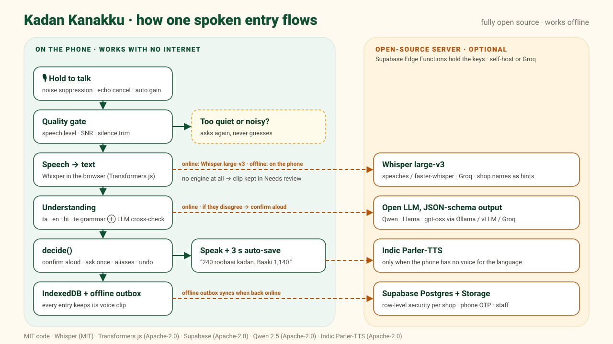

# Kadan Kanakku · 2-minute pitch and demo

## The 2 minutes

| Time | Say | Show |
|---|---|---|
| 0:00–0:20 | "Every kirana shop in Tamil Nadu runs a credit book. Dozens of entries a day, at a noisy counter, hands full. Entries get skipped, amounts get disputed, and month-end becomes an argument. Ledger apps need typing, in English. These owners have no time for that." | Title slide or a photo of a paper *kadan* notebook |
| 0:20–1:20 | "So we made the ledger listen. Watch." Press **▶ Demo** (Home, top right). Narrate the captions as they appear. | Demo autopilot: credit → payment → balance → *Murugasan* (asks which, learns the alias) → new customer → ₹2,500 (confirms first) → voice undo → "two kilo arisi, nootri irubathu" = ₹120 → English → Hindi → today's summary |
| 1:20–1:40 | "Every entry keeps its voice clip. When a customer says *I never took that*, you press play." Open a customer → ▶ on an entry → **Statement** → Save PDF / WhatsApp. | Customer page, statement |
| 1:40–2:00 | "And it's fully open source. Whisper and open LLMs on a server you own, or Whisper running *inside the phone* when there's no internet. Turn on airplane mode, it still works." | Settings → On-device AI (✓ Ready offline), architecture slide |

Before the event: put a UPI ID in Settings so the QR moment works ("Murugan anna-ku QR kaattu", then scan it with a phone from the audience).

Backup if the hall is quiet enough: do two live entries by voice on the phone before the autopilot. Best version: switch on **🎧 Hands-free**, put the phone down, and talk with both hands visibly busy (hold a bag of rice).

Before the event: record the **shop voice** on the demo phone (Settings → Shop voice, about 15 minutes, plus the 6 demo names). The autopilot then answers in a real person's voice instead of the phone's synthetic one, and that is the first thing judges notice.

## Numbers worth saying

- **251 automated tests**: number parsing in 4 languages, every spoken reply in the brief word for word, conversation flows, audio quality gate, hands-free sentence cutting and chatter filtering, the collection list, UPI pay links, offline sync, shop-voice stitching and Tamil number words, and the real database schema with row-level security (run on PostgreSQL via PGlite).
- **Understanding eval** (`npm run eval:nlu`): 74 counter phrases across Tamil (Latin and Tamil script, regional phrasing), English, Hindi and Telugu, all-three-right (intent, customer, amount) **100%**, and **0 silent wrong saves**: a wrong entry is never confident enough to be saved without asking. Honest caveat: we wrote these phrases; the Accuracy lab exists to measure real shopkeepers' voices.
- **On-device Whisper**: an 11-second clip transcribed in 2.1 s in the browser, no network. **Swanada**, a 27 MB model trained on Indian languages, transcribes 4.5 s of audio in 0.3 s.
- **App size**: 146 KB gzipped (the QR code part loads only when a QR is shown); the on-device model (73 MB) downloads only if the owner turns it on.

## Likely questions

**Why not just use a big cloud API?** Shops have patchy internet and thin margins. Open models can run on a cheap server, on Groq's free tier, or on the phone itself. No vendor can switch it off or raise the price.

**What if speech recognition gets it wrong?** Three layers. The quality gate refuses bad audio ("come closer and speak"). The LLM and the deterministic grammar must agree on spoken digits, or the app confirms aloud. Anything above ₹2,000 or below 0.8 confidence is read back before saving. And there's always a 3-second Undo, plus voice undo.

**Why does it sound like a person?** Because it is one. Someone at the shop records about 100 short phrases and number words once, plus each customer's name, and every reply is stitched from those clips, like a railway announcement. Tamil numbers are built from their joining forms (*aayirathi noothi naappadhu* = 1,140). It needs no network, has no delay and no robot accent; any reply that needs a word that wasn't recorded falls back to the phone's voice.

**Hands-free in a busy shop: won't it answer every customer?** No. A 2 MB AI voice detector (Silero) running in the phone cuts the sound into sentences, and outside a conversation the app only acts on a clear ledger command: a name with an amount, a balance question, today's total. Chatter is shown as "ignored" and never answered; a customer's "illa" can never undo an entry. It is deaf while it speaks, so it never hears itself.

**Does it help me get paid?** The home screen says who to collect from today and why ("never paid, 45 days · took ₹310 more this week"), with a WhatsApp reminder one tap away. It leaves alone anyone who paid this week or was reminded yesterday, so it never nags good customers. Every reminder carries a UPI pay link for the exact amount, and at the counter the owner just says "Murugan anna-ku QR kaattu" and turns the phone around. The money goes bank to bank; the app never holds it.

**How do names work if people say them differently?** Names are matched by sound (a "sound skeleton" that folds spelling, script, aspiration and Tamil case endings), honorifics are ignored, and every correction is saved as a shop-specific alias.

**Privacy?** Each shop's data is isolated with Postgres row-level security; audio clips live in a private bucket readable only by that shop's members. Self-hosting keeps everything on your own machines.

**Multiple people at the counter?** The owner shares a 6-digit code; staff sign in with their own phone. Staff can add entries but not hard-delete; every entry records who made it.

**Other languages?** Each language is one file (labels, spoken replies, vocabulary, number words). Hindi and Telugu were added that way.
